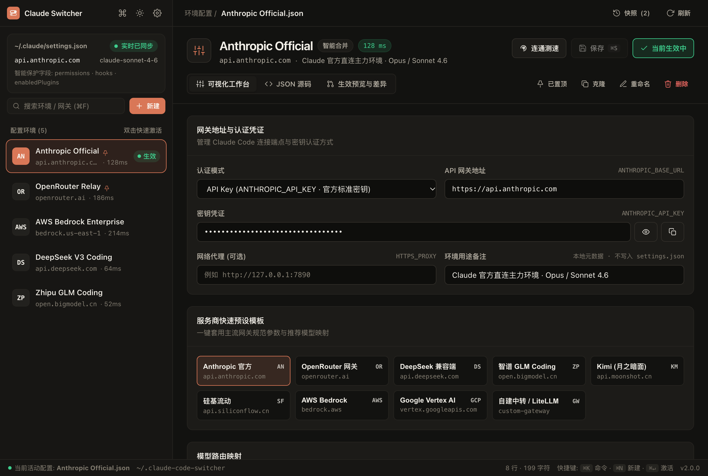

# Claude Code Switcher v2.0

<div align="center">


**面向 Claude Code 的专业多环境、中转网关与模型路由切换工作台**

[](https://github.com/jiji262/Claude-Code-Switcher/releases)
[](https://www.rust-lang.org)
[](https://github.com/jiji262/Claude-Code-Switcher/releases)
[](https://linux.do)
[](LICENSE)

</div>

---

## 产品概览

**Claude Code Switcher v2.0** 彻底重构了桌面架构与产品交互。针对真实开发者在 `~/.claude/settings.json` 中同时维护 `hooks`、`permissions`、`mcpServers` 与多套 API 网关的痛点，v2.0 引入了**智能合并同步引擎 (Smart Merge)**、**三模态可视化工作台**、**网关连通测速**、**双旗舰明暗主题**与**永久原版基线 + 时光机自动快照**。



---

## 下载安装

前往 [**GitHub Releases**](https://github.com/jiji262/Claude-Code-Switcher/releases/latest) 下载对应系统的预编译安装包：

- **macOS (Apple Silicon / Intel)**：提供拖拽安装的 `.dmg` 镜像与 `.app.zip` 应用包
- **Windows (x64)**：提供开箱即用的单文件便携版 `.exe` 与 `.zip` 压缩包（基于系统内置 WebView2）

---

## 核心特性

### 1. 智能合并引擎 (Smart Merge · 默认安全保护)
- **拒绝暴力覆盖**：旧版配置切换直接覆盖整个 `~/.claude/settings.json`，导致辛苦配置的 `hooks`、`permissions`、`enabledPlugins`、`statusLine` 与 `mcpServers` 丢失。
- **精准局部注入**：v2.0 默认采用 **Smart Merge**，切换环境时仅原子更新 API 网关 (`ANTHROPIC_BASE_URL` / `ANTHROPIC_API_KEY` / `ANTHROPIC_AUTH_TOKEN` 等) 与模型路由字段，**100% 原样保留**您的本地工具权限与插件生态；若检测到本地 `settings.json` 语法损坏则自动阻断合并并引导快照修复。

### 2. 三模态工作台与明暗双旗舰主题
- **可视化工作台 (Studio)**：零门槛管理认证模式（Bearer Token / API Key / Claude OAuth 订阅 / AWS Bedrock / Google Vertex AI）、网关地址、Opus/Sonnet/Haiku/Fast 四槽位模型映射、代理服务器、权限默认策略与思考开关。
- **JSON 源码编辑器**：带实时行号装订线、语法校验条与一键格式化 (`⌘⇧F`)，与可视化表单双向无损联动。
- **生效预览与差异 (Smart Diff)**：在点击激活前，通过 LCS 行级对比清晰预览即将对 `~/.claude/settings.json` 产生的真实变更，并默认自动脱敏密钥明文。
- **三态外观切换 (`浅色 · 深色 · 自动`)**：内置 **日光宣纸 (Warm Alabaster)** 浅色主题与 **曜石暗室 (Obsidian Studio)** 深色主题，支持跟随操作系统深浅色零闪烁实时联动。

### 3. 九大主流服务商一键预设
内置开箱即用规范模板，自动填充推荐端点与环境变量结构：
- **Anthropic 官方**（API Key 或 Claude Max 订阅 OAuth）
- **OpenRouter 网关** · **DeepSeek 兼容端** · **智谱 GLM Coding** · **Kimi (月之暗面)** · **硅基流动**
- **AWS Bedrock** · **Google Vertex AI** · **自建中转 / LiteLLM / OneAPI**

### 4. 实时偏离检测、网关测速与时光机快照
- **实时同步雷达**：顶部状态卡片实时比对当前 `~/.claude/settings.json` 与活动配置，若外部手动修改配置，立即提示「检测到外部变更」，支持一键吸纳变更、另存新配置或覆盖同步。
- **安全连通测速**：内置端到端 HTTP/TLS 握手延迟检测（支持 `HTTPS_PROXY` 代理与云厂商端点，通过标准输入传递参数，不在系统进程列表中暴露任何 API Key）。
- **永久原版备份 + 时光机快照**：首次发现原版 `~/.claude/settings.json` 时永久锁定保存一份初始基线备份（不受滚动清理影响），每次切换前自动生成时间戳快照（滚动保留最近 25 份），随时一键预览与无损回滚。

### 5. 桌面与命令行双栖体验
- **全局命令面板 (`⌘K`)**：键盘流极速搜索环境、切换主题、执行测速与快照回滚。
- **内置 CLI 伴侣**：无需打开图形窗口，直接在终端切换环境或恢复备份。

---

## 快速使用

### 命令行模式 (CLI Companion)

编译后的二进制文件同时支持原生 GUI 启动与终端极速切换：

```bash
# 查看当前 ~/.claude/settings.json 同步状态与生效网关
claude-code-switcher --status

# 列出所有已保存的环境配置
claude-code-switcher --list

# 终端一键切换环境（自动执行备份与智能合并）
claude-code-switcher --use "DeepSeek V3 Coding"

# 查看历史备份快照 / 一键恢复初始原版配置
claude-code-switcher --backups
claude-code-switcher --restore --original
```

### 常用快捷键

| 快捷键 | 功能说明 |
| :--- | :--- |
| `⌘K` / `Ctrl+K` | 呼出全局命令面板（极速搜索切换环境与操作） |
| `⌘⇧L` / `Ctrl+Shift+L` | 一键切换浅色（日光宣纸）/ 深色（曜石暗室）主题 |
| `⌘S` / `Ctrl+S` | 保存当前配置更改（若为当前生效配置则自动同步） |
| `⌘↵` / `Ctrl+Enter` | 立即将当前选中环境切换并激活至 `~/.claude/settings.json` |
| `⌘N` / `Ctrl+N` | 打开新建环境预设向导 |
| `⌘F` / `Ctrl+F` | 聚焦左侧环境列表搜索框 |
| `⌘⇧F` / `Ctrl+Shift+F` | 在 JSON 源码视图中格式化并美化代码 |
| `⌘,` / `Ctrl+,` | 打开应用与外观偏好设置 |

---

## 从源码构建

### 环境要求
- **Rust**: 1.75+ ([rustup.rs](https://rustup.rs/))
- **操作系统**: macOS 11+ (Apple Silicon / Intel)、Windows 10/11 (WebView2)、Linux (WebKitGTK)

### 构建步骤

```bash
# 运行核心状态机、智能合并与快照回滚单元测试
cargo test

# 开发调试运行
cargo run --bin claude-code-switcher

# macOS 生产打包（生成独立二进制与已签名的 Claude Code Switcher.app）
./build-macos.sh
```

打包产物位于 `dist/` 目录：
- `dist/Claude Code Switcher.app` — 原生 macOS 应用包（可直接拖入 `/Applications`）
- `dist/claude-code-switcher-macos` — 独立可执行二进制（可软链至 `/usr/local/bin/ccs` 作为命令行工具使用）

---

## 目录与数据说明

Claude Code Switcher v2.0 **100% 向后兼容**旧版数据目录，升级无需迁移：

| 路径 | 用途 |
| :--- | :--- |
| `~/.claude/settings.json` | Claude Code 官方全局活动配置文件 |
| `~/.claude-code-switcher/app_settings.json` | 应用主题、配置仓库路径与当前默认配置记录 |
| `~/.claude-code-switcher/settings/*.json` | 各个独立环境配置的纯净 JSON 文件 |
| `~/.claude-code-switcher/profiles_meta.json` | 环境置顶、备注说明、服务商标识与测速记录元数据（不污染 `settings.json`） |
| `~/.claude-code-switcher/backups/*.json` | 永久原版基线 (`original-claude-settings.json`) 与切换前自动备份快照 |

---

## 技术架构与设计规范

- **原生系统壳层 (`tao` + `wry` + `muda`)**：告别传统打包方案与 16MB 捆绑字体的体积膨胀，直接调用系统原生 WebKit / WebView2 渲染引擎与 macOS 原生菜单栏，单二进制体积轻量、冷启动瞬时响应。
- **设计系统规范**：采用双旗舰主题三层设计令牌架构（`Obsidian Studio` 曜石暗室深色 / `Warm Alabaster` 日光宣纸浅色），详见 [DESIGN.md](DESIGN.md) 与 [docs/brand-guidelines.md](docs/brand-guidelines.md)。
- **独立交互原型**：可在浏览器直接打开免构建交互原型 `designs/claude-code-switcher/preview.html` 体验完整 UI 流程。

---

## 友情链接

- [**LINUX DO**](https://linux.do) — 新的理想型社区：真诚、友善、团结、专业，共建你我引以为荣之社区。

---

## 许可证

本项目采用 [MIT OR Apache-2.0](LICENSE) 双许可证开源。
